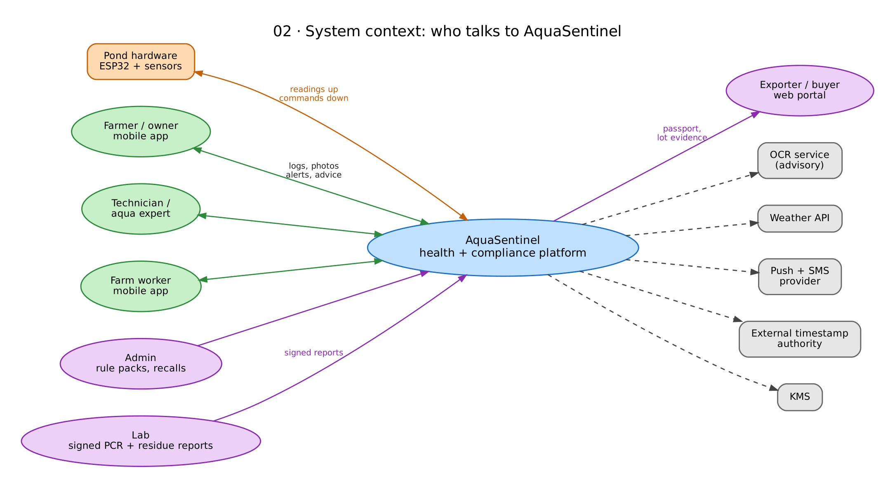
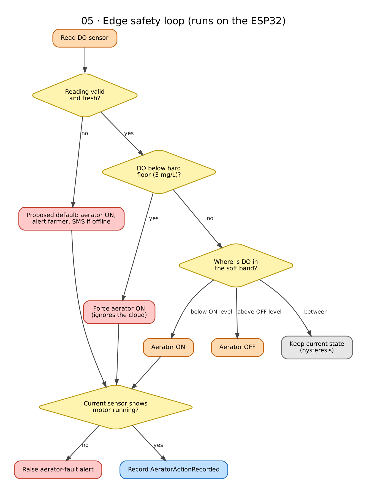
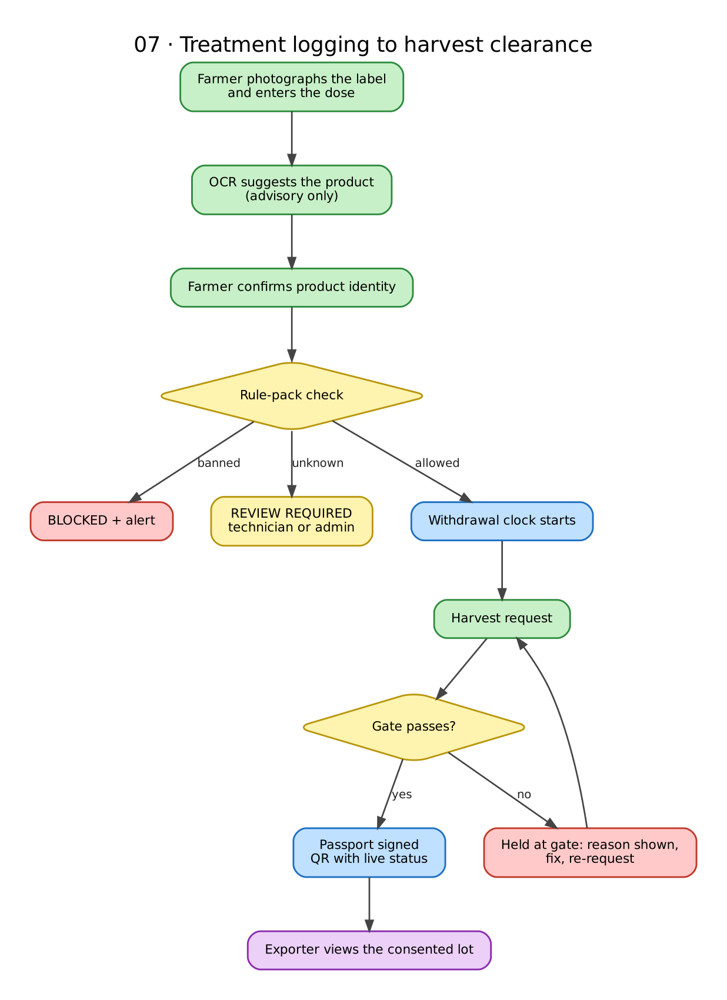
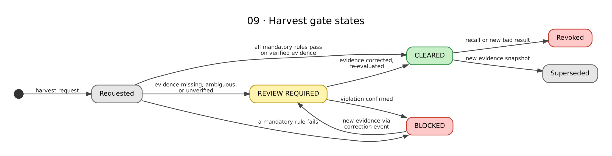
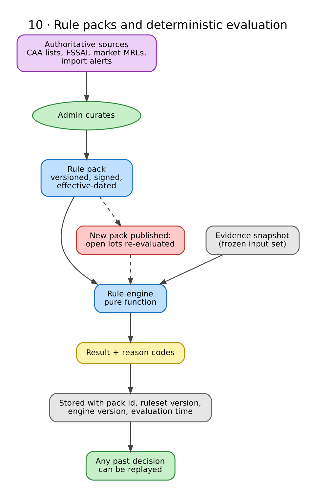
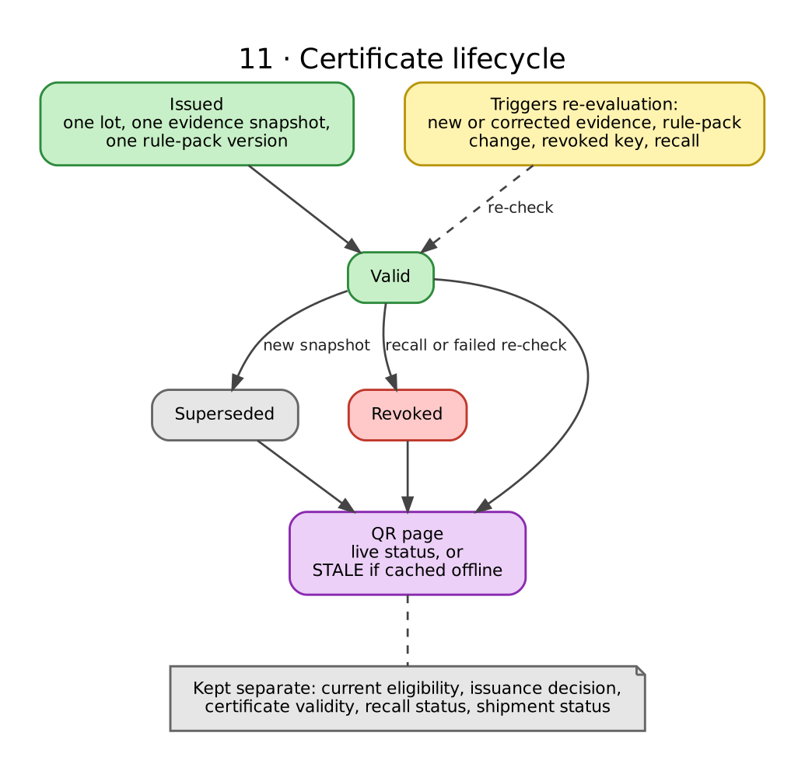
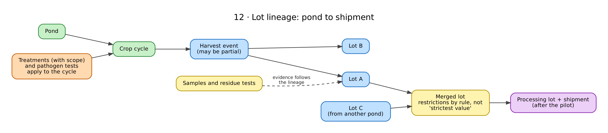
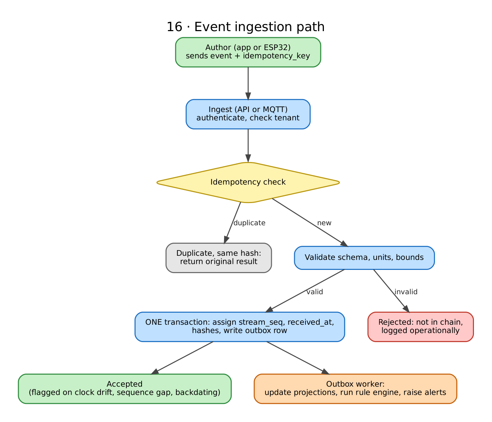

# AquaSentinel

**A pond-to-port health and compliance system for shrimp farms.** AquaSentinel watches pond water with real sensors, keeps aerators running even when the internet is down, and keeps a tamper-evident ledger of treatments and evidence.

> **Status: design stage.** There is no code in this repository yet. Everything below is a proposed design, not a validated product. Claims about regulations and competitors were checked against public sources.

---

## Contents

1. [The problem](#1-the-problem)
2. [What AquaSentinel does and does not claim](#2-what-aquasentinel-does-and-does-not-claim)
3. [How it works](#3-how-it-works)
4. [Architecture](#4-architecture)
5. [Edge safety: protecting the pond](#5-edge-safety-protecting-the-pond)
6. [Compliance: protecting the harvest](#6-compliance-protecting-the-harvest)
7. [Lots, evidence and trust](#7-lots-evidence-and-trust)
8. [The event log](#8-the-event-log)
9. [Who uses it](#9-who-uses-it)
10. [Features and roadmap](#10-features-and-roadmap)
11. [Security and privacy](#11-security-and-privacy)
12. [Pilot plan](#12-pilot-plan)
13. [Planned repository layout](#13-planned-repository-layout)
14. [Open items](#open-items)
15. [References](#references)
16. [License](#license)

**Diagram index**

| # | Diagram | Section |
|---|---|---|
| 01 | Two independent paths | 3 |
| 02 | System context | 4.1 |
| 03 | Container architecture | 4.2 |
| 04 | Pond node hardware | 4.3 |
| 05 | Edge safety loop | 5 |
| 06 | Alert lifecycle | 5 |
| 07 | Treatment to passport flow | 6.1 |
| 08 | Harvest gate decision logic | 6.2 |
| 09 | Harvest gate states | 6.2 |
| 10 | Rule packs | 6.3 |
| 11 | Certificate lifecycle | 6.4 |
| 12 | Lot lineage | 7.1 |
| 13 | Evidence types | 7.2 |
| 14 | Invoice reconciliation | 7.3 |
| 15 | Sensor reading to event | 8 |
| 16 | Event ingestion path | 8 |
| 17 | Event envelope and clocks | 8 |
| 18 | Hash chains and anchoring | 8 |
| 19 | Offline sync | 8 |
| 20 | Roles and consent | 9 |
| 21 | Privacy boundaries | 11 |

Diagrams are PNGs in `docs/diagrams/`, with editable Graphviz sources in `docs/diagrams/src/`. The links below point to those paths so they render correctly on GitHub.

---

## 3. How it works

AquaSentinel runs **two independent paths** on one platform:

| | Safety path | Compliance path |
|---|---|---|
| Protects | The pond today | The harvest's marketability |
| Runs on | ESP32 at the pond | Backend |
| Needs internet? | **No** | Yes (the app works offline and syncs later) |
| Decided by | Local rules | Deterministic, versioned rule engine |
| Fails | Toward aerator **on** | Toward **review required**, never toward green |

The safety path never waits on the cloud. The compliance path never trusts AI.

**Diagram 01.** The two paths share a platform but not a failure mode.

---

## 4. Architecture

### 4.1 System context

### 4.2 Containers and modules

### 4.3 Pond node hardware

---

## 5. Edge safety: protecting the pond

---

## 6. Compliance: protecting the harvest

### 6.1 From treatment to signed passport

### 6.2 The harvest gate

### 6.3 Rule packs

### 6.4 Certificate lifecycle

---

## 7. Lots, evidence and trust

### 7.1 Lot lineage

### 7.2 What each claim is backed by

### 7.3 Invoice and inventory reconciliation

---

## 8. The event log

---

## 9. Who uses it

---

## 11. Security and privacy

---

## License

To be decided. MIT is suggested for the code. Datasets and third-party models keep their own licences; check each one before shipping.
